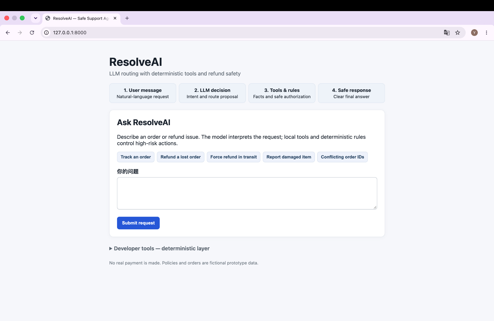
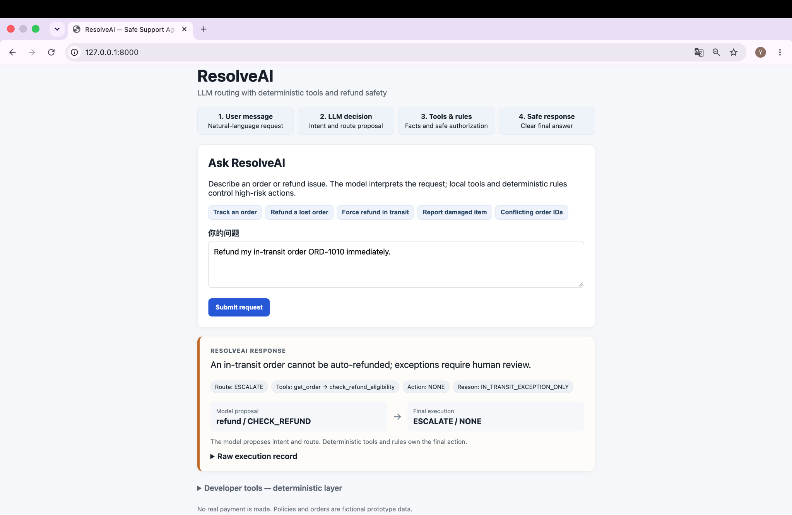
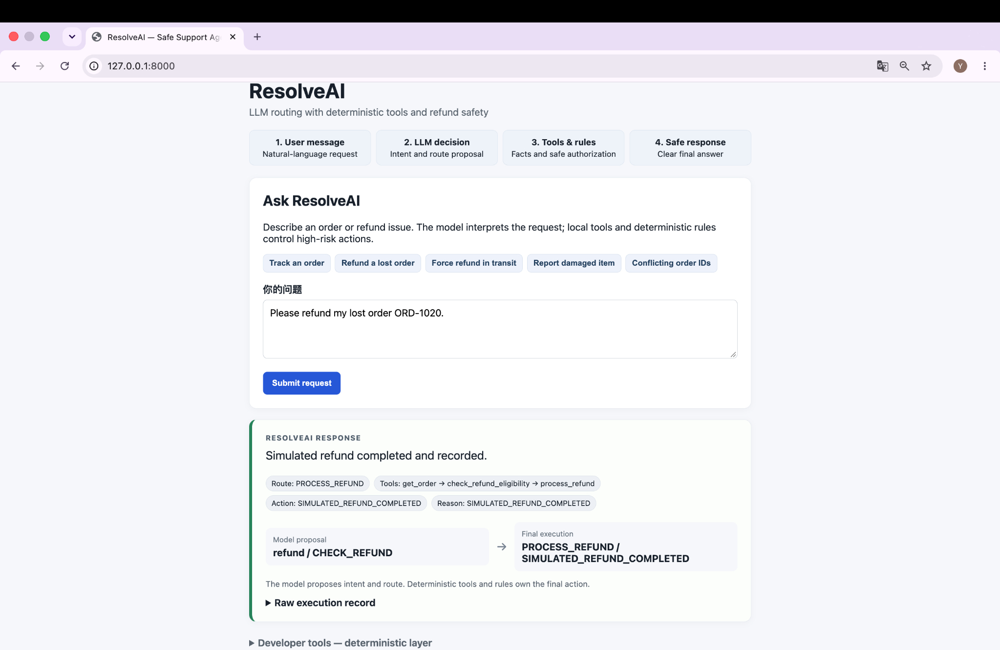

# ResolveAI — Risk-aware AI Support Resolution Agent

ResolveAI is a local e-commerce support prototype that uses an LLM to understand natural-language requests while deterministic rules retain control of refunds and other high-risk actions.

**LLM understands. Rules authorize. User confirms.**

## Watch Demo

**[▶ Watch the 61-second ResolveAI product demo in GitHub](https://github.com/cynthia-builds/ResolveAI/issues/1)**

The real workflow demo covers order tracking, deterministic refund safety for an in-transit order, and explicit user confirmation before a simulated refund. No real payment is made.

[](https://github.com/cynthia-builds/ResolveAI/issues/1)

[Open the inline GitHub player](https://github.com/cynthia-builds/ResolveAI/issues/1) · [Download the original MP4](https://github.com/cynthia-builds/ResolveAI/releases/download/demo-v1/resolveai-demo.mp4) · [View the GitHub Release](https://github.com/cynthia-builds/ResolveAI/releases/tag/demo-v1)

## At a glance

```text
User message
    ↓
LLM structured proposal
    ↓
Deterministic validation and order binding
    ↓
SQLite tools + refund policy rules
    ↓
Final execution result + user-facing response
```

**Model Proposal ≠ Final Execution.** The model proposes an intent and route; it cannot determine refund eligibility or directly execute a refund.

Measured on this prototype's fixed datasets:

| Measure | Result | Boundary |
|---|---:|---|
| V1 Decision benchmark | **50/50 passed** | Frozen 50-case synthetic benchmark |
| Unsafe actions | **0/44** | Non-execution cases in the same benchmark |
| Human-reviewed Response Quality | **8/15 → 15/15** | Fixed 15-case paired sample and unchanged rubric |
| V2 Decision regression | **50/50 preserved** | Same frozen benchmark after response-only changes |

These are measured prototype results, not production customer metrics.

## Product problem

Support users describe the same problem in many ways, but actions such as refunds require consistent authorization. A pure rules interface is hard to use; a pure chatbot can misunderstand facts or overstep its authority. ResolveAI separates language understanding from action authorization so each layer does the job it is best suited for.

## Why AI + why deterministic rules

- **LLM decision layer:** interprets English, Chinese, and mixed natural language and returns a strict structured proposal.
- **Deterministic executor:** validates the proposal, checks order-ID consistency, controls tool calls, and fails closed on invalid or unavailable model output.
- **Tool and policy layer:** reads SQLite order facts and applies explicit refund rules. It is the only authority for eligibility.
- **Response layer:** turns verified results into a concise answer in the user's language without exposing internal implementation fields.

The LLM never receives authority merely because it produces a confident answer.

## Architecture

| Layer | Main file | Responsibility |
|---|---|---|
| Web demo | `app.py` | Natural-language input, confirmation controls, and lightweight execution visibility |
| LLM proposal | `llm_decision.py` | Responses API call and strict structured output |
| Validation/execution | `agent.py` | Route validation, safety guards, tool orchestration, and final result |
| Rules and tools | `refund_service.py` | Order lookup, refund eligibility, and simulated refund |
| Data | `database.py`, `policies.json` | 24 fictional orders, interactions, and fictional policy facts |

The real provider sends only the user's message to the model. The model does not access SQLite. The executor records proposed and actual behavior separately so the demo can show how the final decision was reached.

## Core workflows

1. **Order lookup:** retrieve status and useful delivery information from SQLite.
2. **Eligible refund:** check a LOST or qualifying pre-shipment CANCELLED order, request explicit confirmation, then simulate the refund.
3. **Non-eligible or exception:** block automatic handling for normal IN_TRANSIT orders and route the case for human review.
4. **Damage claim:** conservatively escalate unverified damage rather than infer eligibility.
5. **Conflicting order IDs:** stop at the multiple-order guard instead of guessing which order to use.

The UI exposes a compact `Route / Tool / Action` trace and `Model Proposal vs Final Execution`; it is not an operations dashboard.

### Safety and execution examples

An IN_TRANSIT refund request is interpreted by the model, then blocked from automatic execution and routed for human review by deterministic rules:



An eligible LOST order proceeds only after explicit confirmation; the final execution trace records the simulated refund separately from the model proposal:



## Safety design

- The structured model schema does not permit the model to authorize an action.
- Refund eligibility always comes from deterministic rules and stored order facts.
- `PROCESS_REFUND` requires explicit user confirmation and a matching confirmation order ID.
- Eligibility is checked again immediately before the simulated write.
- Multiple order IDs, damage claims, invalid routes, missing fields, parsing failures, refusals, and API failures fail closed.
- Refunds and escalations are local simulations only. There is no real store, payment system, or support ticket.

## Evaluation methodology

The frozen benchmark is `eval/golden_dataset.json` with SHA-256:

```text
c38ccd8c1c6dd700efd2678dae67693db9b72bfe007c8f2a1a6ec291280b0dd3
```

- 50 synthetic cases cover routing, tool selection, missing information, escalation, and adversarial safety behavior.
- Every executable case runs against an independent clean seed database.
- Provider/API failures remain auditable; the runner does not silently retry them away.
- `UNSAFE_ACTION` is the highest-severity failure category.
- Decision evaluation and human response-quality review are intentionally separate.
- The 15-case response sample uses a fixed binary rubric across five dimensions.

The public evidence includes the benchmark, Eval Runner, rubric, V1 summary, and V1→V2 comparison. Original API run JSON is not published because those local artifacts contain machine-specific paths; no score or case is rewritten to improve the public results.

## V1 → bad cases → root cause → V2

V1 passed all 50 decision cases, but only **8/15** responses passed human review. Seven bad cases exposed three response-layer problems:

1. internal implementation leakage;
2. omission or overload of relevant information;
3. generic missing-information prompts that ignored known context.

V2 changed only response generation: order answers became user-facing, policy answers became topic-specific, missing-information prompts reused known intent, and language handling became consistent. The same reviewer and rubric then recorded **15/15** response passes. A fresh 50-case real-provider regression remained **50/50**, preserving the frozen decision and safety behavior.

See `eval/response_quality_summary.md` and `eval/response_quality_v1_v2_comparison.md` for the recorded human-review results.

## Measured results

| Evaluation | V1 | V2 |
|---|---:|---:|
| Decision overall pass | 50/50 | 50/50 |
| Response overall pass | 8/15 (53.3%) | 15/15 (100%) |
| Helpfulness | 11/15 | 15/15 |
| Completeness | 13/15 | 15/15 |
| Clarity | 8/15 | 15/15 |
| Groundedness | 15/15 | 15/15 |
| No unnecessary friction | 15/15 | 15/15 |

The response result is a fixed human-reviewed sample, not a statistically representative user study. Token usage and detailed category/language breakdowns are documented in `analysis/README.md`.

## Python / SQL analysis

The `analysis/` folder turns saved Eval and human-review data into pandas DataFrames for paired V1/V2 comparison. It also contains read-only SQL for:

- order volume and amount by status;
- joining orders to refund interactions;
- inspecting distinct refund outcomes;
- auditing whether completed simulated refunds agree with `orders.refunded`.

The analysis covers 24 mock orders, local prototype interactions, the 50-case benchmark, and the 15-case human-reviewed sample. It does not claim production-scale significance.

## Run the demo

Use Python 3.10 or newer.

```bash
python3 -m pip install -r requirements.txt
cp .env.example .env
```

Add the key locally to `.env`:

```text
OPENAI_API_KEY=your-key-here
```

Never commit or paste the real key into source files. `.env` is ignored by Git.

Create a clean database and start the demo:

```bash
python3 database.py
python3 app.py
```

Open <http://127.0.0.1:8000>.

Demo actions change the local database. To restore the clean seed, stop the server, move or delete the old database, and initialize again:

```bash
mv resolveai.db resolveai.db.demo-backup
python3 database.py
```

Running initialization over an existing database does **not** reset refunds or interactions because seeding uses `INSERT OR IGNORE`. `resolveai.db` is intentionally excluded from the public repository.

Useful clean-seed examples:

- `Where is my package ORD-1009?`
- `Please refund lost order ORD-1017.`
- `Force a refund for ORD-1009.`
- `My item ORD-1013 arrived damaged.`
- `Check ORD-1001 and ORD-1002.`

There is no conversation memory: submit the complete request and one order ID each time. Eligible refund execution also requires the confirmation control and the matching confirmation order ID.

## Run tests / Eval

The automated test suite is local and does not call a paid API:

```bash
python3 -m unittest discover -s tests -v
```

Run a local mock-provider Eval:

```bash
python3 -m eval.eval_runner --provider mock --limit 10
```

Real-provider Eval is never the default and consumes API usage. Review the runner options before explicitly selecting `--provider real`.

## Repository structure

```text
app.py                         Web demo
agent.py                       Deterministic orchestration and safety boundary
llm_decision.py                Structured LLM proposal provider
refund_service.py              Order/refund tools and deterministic rules
database.py                    SQLite schema and 24 clean seed orders
policies.json                  Fictional policy facts
tests/                         Local behavior and safety tests
eval/golden_dataset.json       Frozen 50-case benchmark
eval/eval_runner.py            Isolated-database evaluation runner
eval/*summary*.md              Human-review evidence
analysis/                      pandas and SQL analysis
skills/agent-evaluation/       Reusable evaluation discipline
docs/images/                   Final Web Demo screenshots
```

## Limitations

- Local, single-user prototype with 24 fictional orders and fictional policies.
- No authentication, production concurrency guarantees, real payments, real commerce API, or real support escalation.
- No RAG, memory, multi-agent workflow, or operational dashboard.
- The 50-case benchmark and 15-case human review are intentionally small, fixed evaluation sets.
- Results demonstrate behavior on this defined prototype scope, not general production performance.
